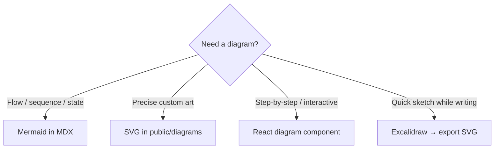

# Content Strategy — Authoring, MDX, and Diagrams

How we write, structure, and render curriculum content — including diagrams inline with text.

---

## Recommendation: MDX in git (Velite)

**Best fit for this platform:**

| Approach | Verdict | Why |
|---|---|---|
| **MDX files in `content/` + Velite** | ✅ Primary | Markdown for prose, React components for diagrams/code, type-safe, git-friendly |
| Giant TypeScript objects (`jsTopics.ts`) | ❌ Retire | Unmaintainable at 40+ topics, bad diffs |
| Headless CMS (Sanity, Contentful) | ⏸️ Phase 6+ optional | Overkill until multiple authors or non-dev editors |
| Notion → export | ❌ | Breaks diagram components, poor version control |
| Pure Markdown (no MDX) | ❌ | Can't embed interactive diagrams or Sandpack |

### Why Velite over Contentlayer

Contentlayer is unmaintained. **Velite** is the modern replacement:
- Builds typed collections from MDX at compile time
- Works with Next.js App Router
- Zod schema validation on frontmatter
- Fast local dev

---

## Content file structure

```
content/
└── tracks/
    └── javascript/
        ├── track.json                 # Track metadata
        ├── foundation/
        │   ├── _category.json         # SubCategory metadata
        │   └── what-is-js.mdx
        └── data-types/
            └── primitive/
                └── strings.mdx
```

### Example topic frontmatter

```yaml
---
title: Strings
slug: strings
track: javascript
subCategory: data-types/primitive
order: 1
estimatedMinutes: 25
prerequisites:
  - what-is-js
keyTakeaways:
  - Strings are immutable in JavaScript
  - Template literals support interpolation and multiline strings
  - UTF-16 encoding affects length for emoji and surrogate pairs
masteryCriteria:
  minQuestionsCorrect: 8
  requireChallenge: false
difficulty: medium
interviewQuestions:
  - id: str-1
    question: Are strings mutable or immutable in JavaScript?
    answer: Strings are immutable. Operations that appear to modify a string create a new string.
    difficulty: easy
    followUps:
      - What happens if you try str[0] = 'X'?
---
```

Body MDX handles definition, examples, deep dives — things that need rich formatting and diagrams.

### Definition voice (`TopicDefinition`)

Write like you are **answering the interviewer**, not quoting MDN. Load `.agents/skills/interview-definition-writing/SKILL.md` before authoring or editing overview copy.

- Lead with a plain 10-second answer, then the hook interviewers probe next.
- Short sentences; concrete before jargon.
- Avoid dictionary phrasing ("X is defined as…").

Every published JS topic should include a **Playground** tab: `<TopicPlayground />` (placeholder until Phase 2) or custom content (e.g. `<EventLoopExplorer />`).

---

## Diagram strategy (your question)

You need diagrams **inline between paragraphs**, **after a section**, or **full-width below text**. Here is the tiered approach:

### Tier 1 — Mermaid in MDX (default, 80% of diagrams)

Best for: flowcharts, sequence diagrams, state machines, class relationships, event loop timing.

```mdx
JavaScript uses a single call stack. When async work completes, callbacks enter the task queue:

<MermaidDiagram caption="Event loop — one tick">
{`flowchart TD
    A[Call Stack] --> B{Stack empty?}
    B -->|Yes| C[Run microtasks]
    C --> D[Run one macrotask]
    D --> A
`}
</MermaidDiagram>

The microtask queue always drains before the next macrotask.
```

**Pros:** Version controlled as text, theme-aware (dark/light CSS), no image files, easy to edit  
**Cons:** Limited styling, not ideal for pixel-perfect art

**Use for:** Event loop, prototype chain, promise chaining, React render flow, middleware pipeline

---

### Tier 2 — Static SVG in `public/diagrams/` (15%)

Best for: precise architecture diagrams, custom illustrations, exported Figma assets.

```mdx
After explaining the V8 compilation pipeline:

<Figure
  src="/diagrams/javascript/v8-pipeline.svg"
  alt="V8 parse, AST, compile, execute pipeline"
  caption="How V8 processes JavaScript source"
/>
```

**Pros:** Pixel-perfect, designer-controlled, works offline  
**Cons:** Manual export step, harder to edit than Mermaid

**Workflow:**
1. Draw in Figma / Excalidraw / draw.io
2. Export SVG (prefer SVG over PNG for sharpness + smaller size)
3. Save to `public/diagrams/{track}/{topic}-{name}.svg`
4. Reference via `<Figure />` component

**Use for:** Engine internals, memory heap layout, complex React fiber tree

---

### Tier 3 — Interactive React diagrams (5%, high value)

Best for: step-through animations, clickable prototype chain, draggable event loop demo.

```mdx
<PrototypeChainExplorer
  objects={[
    { name: 'instance', props: ['name'] },
    { name: 'Constructor.prototype', props: ['greet'] },
    { name: 'Object.prototype', props: ['toString'] },
  ]}
/>
```

**Pros:** Most engaging, can tie to playground  
**Cons:** Expensive to build — only for high-traffic or hard topics

**Use for:** Event loop stepping, closure scope visualization, React reconciliation

Build these as reusable components in `src/components/diagrams/` when a topic justifies it.

---

## MDX component library (content building blocks)

Ship these once, reuse in every topic:

| Component | Purpose |
|---|---|
| `<MermaidDiagram />` | Mermaid flowcharts/sequence (theme-aware) |
| `<Figure />` | Static SVG/PNG with caption |
| `<CodeExample />` | Shiki block + optional `runnable` flag |
| `<Callout type="interview" />` | "Interviewers often ask…" highlight |
| `<Callout type="gotcha" />` | Edge case warning |
| `<Callout type="tip" />` | Quick memory aid |
| `<Compare />` | Side-by-side code or concept comparison |
| `<Quiz />` | Output prediction inline (Phase 2) |
| `<KeyTakeaways />` | Renders frontmatter bullets or inline list |
| `<Sandpack />` | Runnable editor (Phase 2) |

### Placement patterns in prose

```mdx
## Definition

A closure is a function that retains access to variables from its lexical scope...

## Mental model

<MermaidDiagram caption="Closure retains outer scope">
{`flowchart LR
    Outer[outer function scope] --> Inner[inner function]
    Inner --> Ref[references x from outer]
`}
</MermaidDiagram>

## Deep dive: stale closures in React

When you pass a callback to useEffect...

<Figure src="/diagrams/react/stale-closure.svg" caption="Stale closure in a re-render" />

<Callout type="interview">
Interviewers love asking why `count` is stale inside a setInterval callback.
</Callout>
```

---

## Diagram decision tree



---

## Authoring workflow

### For you (primary author)

1. Create `content/tracks/{track}/{category}/{topic}.mdx`
2. Fill frontmatter (title, slug, prerequisites, Q&A in YAML or separate file)
3. Write body in MDX — embed Mermaid where a diagram clarifies
4. For complex visuals: sketch in Excalidraw → export SVG → `public/diagrams/`
5. Run `yarn dev` — preview at `/learn/...`
6. PR review → merge

### Frontmatter vs body split

| In frontmatter (YAML) | In MDX body |
|---|---|
| Metadata (slug, order, prerequisites) | Definition prose |
| Interview Q&A list (structured) | Deep dive sections |
| Mastery criteria | Examples with code |
| Key takeaways | Mermaid + Figure embeds |
| | Callouts, comparisons |

Keep structured data (Q&A, tests) in frontmatter for programmatic use (flashcards, progress). Keep narrative + diagrams in body.

---

## Theming diagrams for dark/light mode

### Mermaid
- Use `theme: 'base'` with CSS variables matching shadcn tokens
- `MermaidDiagram` component reads `resolvedTheme` from next-themes

### SVG
- Prefer `currentColor` for strokes/fills where possible
- Or ship `topic-name.light.svg` + `topic-name.dark.svg`
- Or single SVG with CSS `@media (prefers-color-scheme)`

### PNG
- Avoid when possible — doesn't theme well
- If needed, provide light + dark variants

---

## Alternative tools (when to use what)

| Tool | Best for | Export to |
|---|---|---|
| **Mermaid** | Flow, sequence, ER, state | MDX code block |
| **Excalidraw** | Hand-drawn feel, whiteboard style | SVG |
| **Figma** | Polished product/education diagrams | SVG |
| **draw.io** | Architecture boxes, quick edits | SVG |
| **PlantUML** | Strict UML | SVG (via export) |
| **D2** | Text-based diagrams (Mermaid alternative) | SVG |

**Recommendation:** Mermaid for day-to-day authoring. Excalidraw or Figma when Mermaid isn't expressive enough.

---

## Interview Q&A storage options

**Option A — Frontmatter array (good for <15 questions per topic)**

```yaml
interviewQuestions:
  - id: str-1
    question: ...
    answer: ...
    difficulty: easy
```

**Option B — Separate `strings.questions.yaml` (good for large question banks)**

Keeps MDX body readable. Velite merges at build time.

**Option C — `<InterviewQuestion />` in MDX (good for narrative Q&A)**

Use when answer needs diagrams inline.

Start with **Option A** for MVP. Move to B or C when topics have 20+ questions or answers need embedded diagrams.

---

## Content quality checklist (per topic)

- [ ] Definition is plain language, not MDN copy-paste
- [ ] At least one diagram where concept is visual (event loop, prototype chain, etc.)
- [ ] Code examples are runnable or marked as pseudo
- [ ] Deep dive covers at least one "gotcha" interviewers probe
- [ ] Q&A has follow-ups on hard questions
- [ ] `estimatedMinutes` is realistic
- [ ] Prerequisites are correct
- [ ] Key takeaways are 3–5 bullets max

---

## Future: CMS only if

- Non-developers need to edit without git
- You need scheduled publishing
- Localization (i18n) becomes a requirement
- Content volume exceeds comfortable git workflow

Until then, **MDX in git is faster, cheaper, and version-controlled** — ideal for a solo or small team building elite content.
