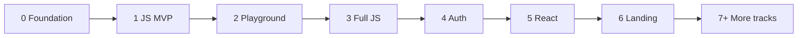
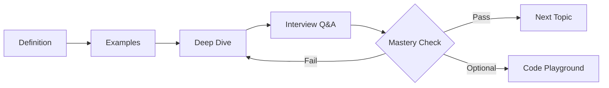

# Roadmap — Elite Interview Prep Platform

Phased delivery plan. Each phase ships usable value before the next starts.

---

## Phase overview



---

## Phase 0 — Foundation

**Goal:** Proper project skeleton and documentation.

**Deliverables:**
- [x] Project docs (CONTEXT, ROADMAP, BRAND, ARCHITECTURE, CONTENT-STRATEGY, PROJECT-CONVENTIONS)
- [x] Next.js App Router scaffold (v15 — upgrade to 16 when stable)
- [x] Migrate shadcn/ui components (button, scroll-area, collapsible)
- [x] ThemeProvider + dark/light toggle
- [x] Remove unused deps (MUI, Vite) and legacy prototype files
- [x] Velite MDX pipeline + event-loop topic preview at `/learn/javascript/execution/event-loop`
- [x] Update AGENTS.md for this product

**Exit criteria:** ✅ `yarn dev` runs Next.js app with theme toggle and learn layout.

---

## Phase 1 — JS MVP

**Goal:** First usable learning experience with real content.

**Deliverables:**
- [x] MDX content pipeline (Velite or equivalent)
- [x] Dynamic route: `/learn/javascript/[...slug]`
- [x] 3-panel layout ported (MainSidebar, SubSidebar, ContentArea)
- [x] 10 core JS topics in MDX (strings, numbers, objects, arrays, closures, event loop, promises, this, prototypes, hoisting)
- [x] Syntax-highlighted code blocks (Shiki)
- [x] Prev/Next topic navigation
- [x] Local progress hook (`localStorage`) — visited, self-scored Q&A
- [x] Shareable URLs per topic

**Exit criteria:** ✅ A learner can complete 10 topics end-to-end with progress persisted locally.

---

## Phase 2 — Interactive JS

**Goal:** Differentiate with hands-on practice.

**Deliverables:**
- [x] Sandpack playground tab (all 10 MVP topics)
- [x] Output prediction exercise (Promises, Event Loop, Strings, Numbers, Hoisting, This)
- [x] Flashcard mode for interview Q&A (all 10 MVP topics)
- [x] Coding challenges with console tests (Closures, Arrays, Objects, Prototypes)
- [x] Event Loop step-through explorer + output prediction drill

**Exit criteria:** ✅ Learner can run code, predict output, and pass at least one challenge per relevant topic.

---

## Phase 3 — Full JS track

**Goal:** Complete JavaScript curriculum (~40 topics).

**Deliverables:**
- [x] Full curriculum map (40 topics — see CURRICULUM.md)
- [x] Mastery criteria per topic (min Q&A score, optional challenge)
- [x] Topic locking / prerequisites (soft nudge; optional hard lock via localStorage)
- [x] Progress ring and mastered badges in sidebar
- [x] Key takeaways card on each topic
- [x] Follow-up prompts on interview questions

**Exit criteria:** ✅ Full JS track navigable with mastery gates and progress UI.

---

## Phase 4 — Auth + persistence

**Goal:** Cross-device progress and user accounts.

**Deliverables:**
- [x] Better Auth (email/password; Google OAuth when env credentials set)
- [x] Postgres + Drizzle schema for progress (Docker local; Neon for deploy)
- [x] Progress API (`/api/progress`)
- [x] Migrate localStorage progress on sign-in
- [x] Streaks, time spent per topic, points
- [x] Resume where you left off

**Exit criteria:** Sign in on two devices → same progress everywhere.

**Skills to load:** `better-auth-best-practices`, `better-auth-security-best-practices`, `create-auth-skill`, `oauth`

---

## Phase 5 — React track

**Goal:** Second curriculum using same infrastructure.

**Deliverables:**
- [x] React track MDX content (hooks, reconciliation, performance, etc.) — 17 topics
- [x] Track picker in main sidebar (JS | React — active tracks only)
- [x] Cross-track progress overview (logged-in sidebar)
- [x] React-specific playground (JSX via Sandpack `react` template)

**Exit criteria:** React track live with same UX as JS track.

---

## Phase 6 — Landing + SEO

**Goal:** Public-facing marketing and discoverability.

**Deliverables:**
- [x] Landing page (BRAND.md + DESIGN-ETHICS.md)
- [x] SEO metadata per topic page
- [x] FAQ section (question-shaped H2s for AEO)
- [x] Open Graph / social previews (`opengraph-image.tsx`)
- [x] Sitemap + robots.txt

**Exit criteria:** Landing converts; topic pages indexable.

---

## Phase 7+ — Additional tracks

One track at a time, reusing all components:

| Track | Unique focus |
|---|---|
| **Next.js** | RSC, caching, routing, SSR/SSG/ISR |
| **Node.js** | Event loop vs browser, streams, cluster, libuv |
| **Express** | Middleware chain, error handling, security |
| **Hono** | Edge runtime, middleware, vs Express |
| **NestJS** | DI, modules, guards, pipes, decorators |

---

## Feature backlog (by priority)

### Phase 1–3 (core)
- Topic pages with 4 tabs
- Shareable URLs
- Local progress
- Syntax-highlighted code
- Prev/Next navigation
- Dark/light mode

### Phase 2 (interactive)
- Sandpack playground
- Output prediction exercises
- Coding challenges + test runner
- Flashcard mode for Q&A

### Phase 4 (accounts)
- Auth + synced progress
- Streaks, time tracking
- Resume session

### Phase 5+ (elite differentiators)
- **Mock interview mode** — timed Q&A with follow-ups
- **Weak area report** — topics scored low
- **Spaced repetition** — resurface Q&A on schedule
- **Company-specific packs** — FAANG JS round, startup full-stack
- **Compare answers** — learner answer vs model (optional AI)
- **System design tie-ins** — cross-links between topics

### Phase 6+ (scale)
- Contributor MDX workflow (PR-based content)
- Admin analytics on hardest questions
- Optional headless CMS (only if git-based workflow becomes painful)

---

## Curriculum: JavaScript track (~40 topics)

```
Foundation
├── Basics (what-is-js, how-js-runs, strict-mode)
├── Variables & Scope (var/let/const, hoisting, TDZ, scope chain)
└── Execution (call stack, event loop, micro/macro tasks)

Data Types
├── Primitives (strings, numbers, bigint, boolean, null, undefined, symbol)
├── Reference (objects, arrays, maps, sets, weak collections)
└── Type coercion & equality (== vs ===, truthy/falsy)

Functions
├── Declarations (function, arrow, IIFE)
├── Closures & lexical scope
├── this binding (4 rules, bind/call/apply)
└── Higher-order & currying

OOP & Prototypes
├── Prototype chain & __proto__
├── Classes (ES6), inheritance, static
└── Object.create, mixins

Async
├── Callbacks, promises, async/await
├── Promise combinators (all, race, allSettled)
└── Error handling patterns

ES6+ Features
├── Destructuring, spread/rest, template literals
├── Modules (import/export, dynamic import)
└── Iterators, generators, symbols

Advanced (interview gold)
├── Event loop deep dive + output prediction
├── Memory (GC, leaks, WeakRef)
├── Design patterns in JS (module, observer, factory)
└── Polyfills (bind, call, apply, Promise, debounce)
```

---

## Learning flow (product core)



Every topic follows: **Understand → Apply → Go deep → Prove it → Gate progress.**

---

## What we explicitly avoid

- Fragmented Q&A-only sites with no depth
- Video-only courses with no structured progression
- Hard paywalls before MVP is validated
- Multiple UI libraries (MUI, Chakra, etc.)
- Content locked in giant TypeScript files
- Neon gradients, AI-slop purple, dense feature grids (see DESIGN-ETHICS.md)

---

## Success metrics (post-launch)

| Metric | Target |
|---|---|
| Topic completion rate | >60% of started topics mastered |
| Return visits | >3 sessions/week for active learners |
| Time on topic | Matches `estimatedMinutes` ±30% |
| Q&A self-score improvement | Higher on revisit (spaced repetition) |
